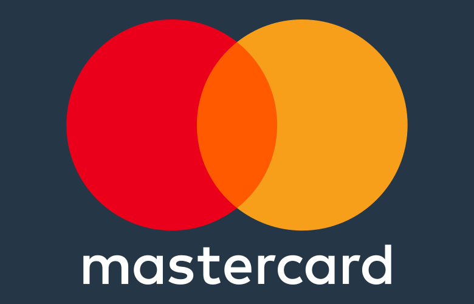
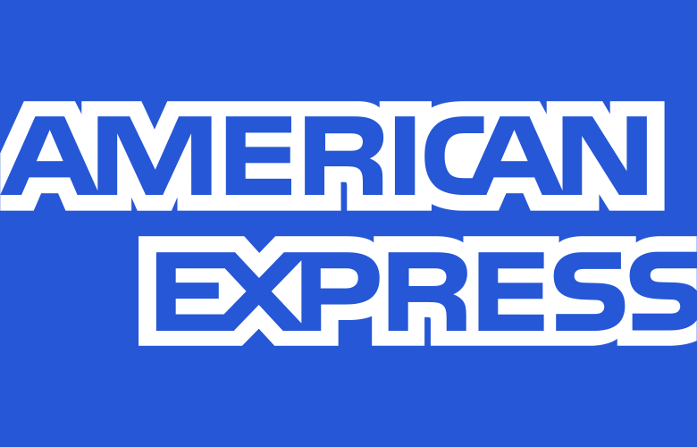
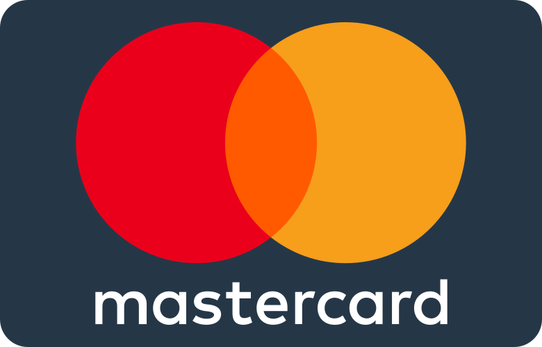
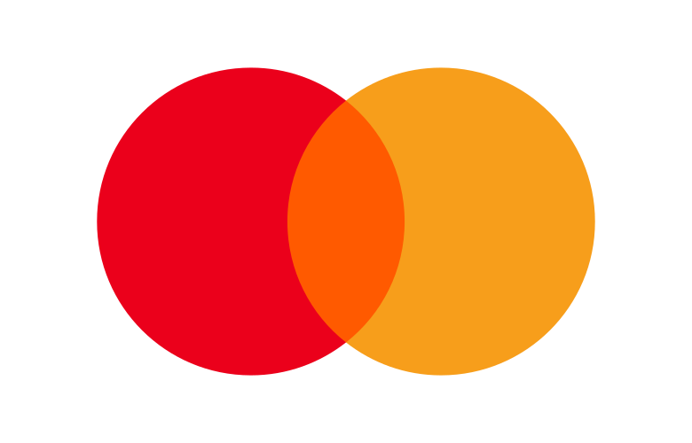
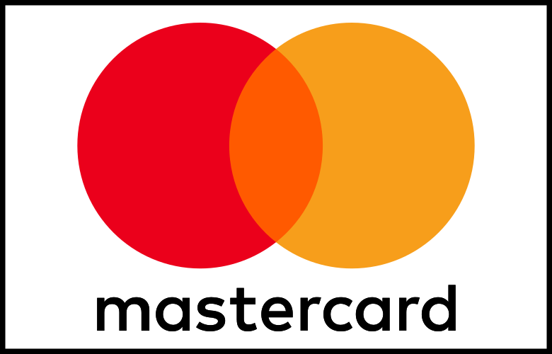

# Parkes Payment Icons

Payment method icons for Rails. Includes 102 SVGs in six styles, with view helpers
and support for Propshaft and Sprockets.

## Installation

Add to your Gemfile:

```ruby
gem "parkes-payment-icons", "~> 0.1.0"
```

Then run `bundle install`.

Requires Ruby 3.2+ and Rails 7.0–8.1. Use a Ruby version supported by your Rails version.

### Propshaft

No additional setup is required.

### Sprockets 4

Add the collection to `app/assets/config/manifest.js`:

```js
//= link parkes_payment_icons.js
```

To include individual icons instead:

```js
//= link payment_icons/logo/visa.svg
```

## Usage

### Render an icon

```erb
<%= payment_icon_tag :visa, width: 40 %>
<%= payment_icon_tag :mastercard, variant: :flat_rounded, class: "payment-logo" %>
<%= payment_icon_tag :amex, variant: :mono, size: "40x25", alt: "American Express" %>
```

`payment_icon_tag` renders an `` and accepts the same HTML options as Rails'
`image_tag`. The default variant is `logo`.

Names and variants accept strings or symbols. Underscores and hyphens are
interchangeable: `:flat_rounded` and `"flat-rounded"` select the same style.
Unknown names or variants raise `ArgumentError`.

Alt text defaults to the icon name, capitalized. Pass `alt: ""` for decorative
icons, or supply your own label:

```erb
<%= payment_icon_tag :visa, width: 40, alt: "", aria: { hidden: true } %>
```

### Get an asset path

```erb
<%= payment_icon_path :visa %>
<%= payment_icon_path :visa, variant: :logo_border %>
<%= payment_icon_path :visa, host: "https://assets.example.com" %>
```

`payment_icon_path` accepts Rails' `image_path` options. Both helpers use the
asset pipeline, including digested URLs in production.

You can also reference assets directly:

```erb
<%= image_tag "payment_icons/logo/visa.svg", alt: "Visa", width: 40 %>
```

## Icons

Each of these 17 icons is available in all six styles:

`alipay`, `amex`, `code`, `code-front`, `diners`, `discover`, `elo`, `generic`,
`hiper`, `hipercard`, `jcb`, `maestro`, `mastercard`, `mir`, `paypal`, `unionpay`,
and `visa`.

Use `generic` as a fallback for unknown payment brands.

| Style | Visa | Mastercard | American Express |
| --- | --- | --- | --- |
| `flat` |  |  |  |
| `flat_rounded` |  |  |  |
| `logo` |  |  |  |
| `logo_border` |  |  |  |
| `mono` |  |  |  |
| `mono_outline` |  |  |  |

## Development

```sh
bin/setup
bundle exec rake test upstream:check compatibility
```

To check a different Rails version or asset pipeline:

```sh
RAILS_VERSION='~> 7.2.0' ASSET_PIPELINE=sprockets bundle exec rake compatibility
```

### Update the icons

Import a specific upstream commit, then verify the collection:

```sh
bundle exec rake 'upstream:update[FULL_COMMIT_SHA]'
bundle exec rake upstream:verify test compatibility
```

The update task replaces the icon collection and records the source revision and
checksums in [upstream.json](upstream.json).

See [Contributing](CONTRIBUTING.md) and the [release guide](docs/RELEASING.md).

## License

[Apache-2.0](LICENSE). Icons by [Aaron Fagan and contributors](https://github.com/aaronfagan/svg-credit-card-payment-icons).
See [NOTICE](NOTICE) for attribution. Payment brand trademarks belong to their respective owners.
